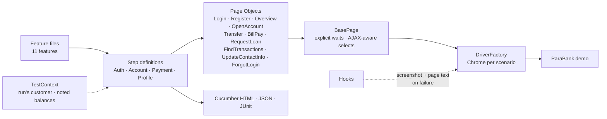

<div align="center">

# 🏦 ParaBank Banking Automation

### Java + Selenium + Cucumber suite for the ParaBank online-banking demo — accounts, transfers, bill pay, loans, profile

[](https://git.io/typing-svg)

<!-- ============ STATUS BAR ============ -->
[](https://github.com/rbchy/ParaBank-BankingAutomationJavaSelenium/actions/workflows/tests.yml)
-22c55e?style=for-the-badge&logo=checkmarx&logoColor=white)


</div>

---

## 📌 At a Glance

<table>
<tr>
<td width="50%" valign="top">

**🙋 What this is**

A BDD suite for **[ParaBank](https://parabank.parasoft.com/parabank/)**, Parasoft's public online-banking demo. Gherkin scenarios drive Page Objects through Selenium across the core banking journeys: registration, login / logout, accounts overview, opening accounts, fund transfers, bill pay, loans, transaction search, contact info and *Forgot login info*.

Every run **registers its own customer**, so the checks never depend on accounts someone else changed on the shared demo. Balances are read before and after money moves and compared to the cent.

> *A test that cannot fail is not a test — and a test that finds a real bug says so.*

</td>
<td width="50%" valign="top">

**📍 Quick facts**

| | |
|---|---|
| 🧪 **Scenarios** | 20 in 11 feature files (+ 3 `@known-defect`) |
| ✅ **CI** | 20 / 20 · headless Chrome · ≈ 70 s of tests |
| 🐞 **Defects found** | 3 in the public demo — tracked in their own CI job |
| 🏷️ **Tags** | `@smoke` · `@regression` · `@negative` · `@known-defect` |
| 📊 **Reports** | Cucumber HTML · JSON · JUnit XML · Surefire |

</td>
</tr>
</table>

---

## ✅ Latest Results

| Feature | Scenarios | What is asserted | Result |
|---|---:|---|---|
| 📝 Registration | 3 | *Welcome &lt;username&gt;* · passwords that differ → *"Passwords did not match."* · taken username → *"This username already exists."* |  |
| 🔐 Login | 2 | Valid login opens *Accounts Overview* · empty form → *"Please enter a username and password."* |  |
| 🚪 Logout | 1 | Back on the home page, login form shown, *Log Out* gone |  |
| 📋 Accounts Overview | 1 | Every account number is numeric · the *Total* row equals the sum of balances |  |
| ➕ Open New Account | 2 | SAVINGS and CHECKING → *"Account Opened!"*, new number listed in the overview |  |
| 💸 Fund Transfer | 1 | *"Transfer Complete!"* with amount and both accounts · source **−$25.00**, target **+$25.00** |  |
| 🧾 Bill Pay | 2 | Confirmation shows payee and amount · mismatched account numbers rejected |  |
| 🏠 Request Loan | 2 | Affordable loan → *Approved* + loan account · down payment above balance → *Denied* |  |
| 🔎 Find Transactions | 2 | A transfer is found by its amount (*Funds Transfer Sent*) · date range returns results |  |
| 👤 Update Contact Info | 2 | Form shows the registered details · empty first name → *"First name is required."* |  |
| 🔑 Forgot Login Info | 2 | Name + address + SSN find the username · unknown SSN → *not found* |  |
| **Total** | **20** | | **100 %** |

<sub>GitHub Actions, Ubuntu 24.04, Temurin 17, headless Chrome ([workflow](.github/workflows/tests.yml)).</sub>

---

## 🐞 Defects Found in the Public Demo

These scenarios are tagged `@known-defect`. They run on every push in a separate **non-blocking** CI job, so the day Parasoft fixes one, that job turns green.

| # | Scenario | Expected | What ParaBank does |
|---|---|---|---|
| 1 | Log in with an unknown username / wrong password | *"The username and password could not be verified."* | Logs the visitor in **as an existing customer** (first *John Smith*, later the most recently registered customer) |
| 2 | Update Contact Info → *Update Profile* | *"Profile Updated"* and the new values saved | The page sends `username=&password=` empty with the update; the server answers *"An internal error has occurred"* and nothing is saved |
| 3 | Bill Pay, then check the account | Balance lower by the amount, *Bill Payment to …* in the transactions | *"Bill Payment Complete"* is shown, but the balance is unchanged and no transaction is recorded |

Defect 1 was confirmed with plain HTTP calls from a fresh client (no cookies) as well as in the browser.

---

## 🏗️ Framework Architecture



- **Own test customer** — the first scenario that needs a logged-in user registers a unique customer; later scenarios log in with it
- **Money checks to the cent** — balances are read with `BigDecimal` before and after a transfer and compared exactly
- **AJAX-aware waits** — ParaBank fills account lists and forms after the page loads; `BasePage` waits for options and values, and retries on stale elements — no `Thread.sleep`
- **Readable failures** — on failure the hook attaches a screenshot and prints the page text and the REST calls the page made, so a CI failure can be read straight from the log
- **Config, not code** — URL, timeout and headless in `config.properties`; any value can be overridden with `-D`

---

## 🛠️ Tech Stack

| Layer | Technology | Version |
|---|---|---|
| Language | Java | 17 |
| Browser automation | Selenium WebDriver (Selenium Manager) | 4.27.0 |
| BDD | Cucumber JVM | 7.20.1 |
| Runner | TestNG (`cucumber-testng`) | 7.10.2 |
| Build | Maven (Surefire, `testng.xml`) | 3.x |
| CI | GitHub Actions | — |

---

## 📁 Project Structure

```
ParaBank-BankingAutomationJavaSelenium/
├── .github/workflows/tests.yml          ← main suite + non-blocking @known-defect job
├── src/test/java/
│   ├── hooks/Hooks.java                 ← Chrome per scenario, failure screenshot + page text
│   ├── pages/                           ← BasePage + 10 page objects
│   ├── stepdefinitions/                 ← AuthSteps, AccountSteps, PaymentSteps, ProfileSteps
│   ├── runners/TestNGCucumberRunner.java
│   └── utils/                           ← DriverFactory, Config, Customer, TestContext
├── src/test/resources/
│   ├── config.properties
│   └── features/                        ← 11 feature files
├── testng.xml
└── pom.xml
```

---

## ⚙️ Getting Started

**Prerequisites:** JDK 17+ · Maven 3.8+ · Google Chrome

```bash
git clone https://github.com/rbchy/ParaBank-BankingAutomationJavaSelenium.git
cd ParaBank-BankingAutomationJavaSelenium

mvn clean test                                          # all scenarios except @known-defect
mvn clean test -Dheadless=true                          # what CI runs
mvn clean test -Dcucumber.filter.tags="@smoke"          # smoke only
mvn clean test -Dcucumber.filter.tags="@known-defect"   # reproduce the demo defects
```

| Report | Location |
|---|---|
| Cucumber HTML | `target/cucumber-report.html` |
| Cucumber JSON / JUnit XML | `target/cucumber.json` · `target/cucumber.xml` |
| Surefire | `target/surefire-reports/` |

---

## 🧹 Maintenance Log

| Change | Why |
|---|---|
| Added `pom.xml`, step definitions and page objects for every module | The repo had feature files and one page object but **no build file and no step definitions**, so nothing could compile or run here |
| Removed `LoginTest` and `ExcelUtils` | `LoginTest` used a `LoginPage` class and a `testdata/LoginData.xlsx` file that did not exist |
| Feature files rewritten for the real demo | They used fixed account numbers `12345` / `54321` that do not belong to the logged-in customer |
| Each run registers its own customer | The shared `john` / `demo` account is changed by everyone who uses the demo |
| Negative scenarios added | Wrong / empty login, password mismatch, duplicate username, account mismatch, denied loan, required first name, unknown SSN |
| Three demo defects tagged `@known-defect` | They fail because of ParaBank, not the tests — see *Defects Found* |
| GitHub Actions | Every push is checked; reports kept as artifacts |
| README describes only what exists | The old README described a Spring Boot + MySQL backend, an HTML/JS frontend, JUnit 5 and a `ranajitchowdhury` GitHub account — none of it is in this repo. The PDF report (*9 passed*) came from a local project whose step code was never committed |

---

## 📈 Roadmap

- [x] Runnable framework, real assertions, GitHub Actions
- [x] Demo defects reproduced and tracked in CI
- [ ] REST Assured checks against ParaBank's `services/bank` API (accounts, transfers)
- [ ] Cross-check UI balances against the API after every money move
- [ ] Firefox and Edge in a CI browser matrix
- [ ] Extent report with failure screenshots

---

## 🔗 Related Projects

| Project | Stack |
|---|---|
| 👥 [OrangeHRM BDD Automation](https://github.com/rbchy/OrangeHRM_Automation) | Java · Selenium · Cucumber · TestNG — CI green |
| 🏥 [OpenEMR Healthcare](https://github.com/rbchy/OpenEMR_Automation) | Java · Selenium · Cucumber · TestNG — CI green |
| 🧪 [QA Brains — Java + Selenium](https://github.com/rbchy/QaBrainsAutomationJavaSelenium) | Java · Selenium · Cucumber — CI green |
| ⭐ [RbcTcsWorld E-Commerce Suite](https://github.com/rbchy/RbcTcsWorld_ECommerceSuite) | Spring Boot · REST Assured · Selenium · Playwright · CI quality gates |

<sub>All projects: [github.com/rbchy](https://github.com/rbchy)</sub>

---

## 👤 Author

<div align="center">

**Ranajit Baran Chowdhury (RB Chowdhury)**
QA Automation Engineer / SDET · West Norriton, Pennsylvania, USA

[](https://www.linkedin.com/in/rbchy/)
[](https://github.com/rbchy)
[](https://rbchy.github.io/rbchy/)
[](https://rbc6543.wixsite.com/rbc-portfolio)
[](mailto:chyranajit@gmail.com)

<sub>ParaBank is a public demo by Parasoft that is shared and reset regularly; the suite only uses customers it registers itself.</sub>

⭐ *If this project helps you, a star on the repo is appreciated.*

</div>
